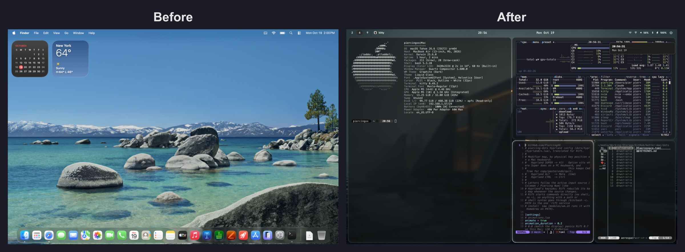

# better-mac



The macOS sibling of [linux-mod](https://github.com/PiercingXX/linux-mod).
One script turns a fresh Mac into the PiercingXX setup: bash 5 and GNU tools,
piercing-dots (bashrc, kitty, nvim, tmux, yazi), the arch-mini-mod apps,
Colemak + Piercing Num, and a Hyprland-style tiling desktop.

## How to use

### 1. Fresh Mac: get git

`git` on a new Mac is a stub. Open Terminal and install the Command Line Tools:

```bash
xcode-select --install
```

### 2. Clone and run

```bash
git clone https://github.com/PiercingXX/better-mac.git
cd better-mac
./better-mac.sh --dry-run    # optional: see every step, change nothing
./better-mac.sh
```

The repo is private, so `git clone` asks for a username and password: use
`PiercingXX` and a GitHub personal access token (Settings > Developer settings >
Tokens, `repo` scope) as the password. A fresh Mac has no `gh` to log in with yet.

Run it as your normal user. It asks for your password once (Homebrew,
login shell, power, firewall, Remote Login) and keeps sudo alive.
Homebrew is installed if it's missing. Expect 20-40 minutes, mostly downloads.

### 3. Click through the permission panes

macOS doesn't let scripts grant these. At the end the script opens each pane
and waits for you to press Enter:

| Pane | Turn on |
|---|---|
| Privacy > Accessibility | rift (+ `/opt/homebrew/bin/rift` if it isn't listed), Sol, piercing-gestures, piercing-menubar |
| Privacy > Screen & System Audio Recording | rift (the ⌥E screenshot keys) |
| Privacy > Input Monitoring | karabiner_grabber, karabiner_observer |
| Karabiner-Elements window | its driver extension and login items |
| Sol welcome window | hotkey **⌥ Space** (tapping Option sends it), clipboard shortcut **⌥ ⇧ Y** (the script adds Sol as a login item) |
| Keyboard > Text Input > Edit | add **Colemak** and **Piercing Num** (under Others), remove U.S. |

### 4. Reboot

The menu bar auto-hide, Spaces, dark mode and trackpad settings apply after a
fresh login, and `/media` (see `modules/scripts.sh`) appears after a reboot. Rift, SketchyBar, borders, Karabiner, Sol and Tailscale start at login from
then on.

### 5. First launches

- `nvim`: plugins install on first launch (`vim.pack`).
- tmux plugins are already installed; `prefix + I` re-runs TPM.
- Press **⌥ /** for the keybind sheet, and type `xx` for the settings menu.
- The notifiers (time, battery, network, Bluetooth, updates) show as
  mako-style popups from `piercing-notify`, which needs no permission. The
  first lock, wallpaper or screenshot asks for Automation / Screen Recording
  permission.
- Key repeat, the accent color and "don't reopen windows" apply after you
  log out once.

### Re-running

Safe to rerun at any time; it's how you pull in piercing-dots changes.
Anything it replaces is kept as `<name>.bak.<timestamp>`, and a rerun with
no upstream changes touches nothing.

```bash
cd better-mac && git pull && ./better-mac.sh
```

| Flag | |
|---|---|
| `printers [canon\|omezizy\|both]` | set up a USB printer instead of the full install (see below) |
| `--dry-run` | print every action instead of running it (works on Linux too) |
| `--no-color` | plain output (`NO_COLOR` also works) |
| `-h`, `--help` | usage |

`PIERCING_DOTS_DIR=/path/to/piercing-dots` or
`PIERCING_KEYBOARD_DIR=/path/to/piercing-keyboard-layout` use a local
checkout instead of cloning.

### Printers

Plug the printer in over USB, then:

```bash
./better-mac.sh printers            # both
./better-mac.sh printers canon      # Canon D530 -> queue Canon-D530 (default printer)
./better-mac.sh printers omezizy    # Omezizy / XPrinter XP-420B -> queue Omezizy_Label, 4x6 labels
```

Same queues and label options as linux-mod's Printers menu. macOS ships CUPS,
but the drivers come from the vendors: if one isn't installed, the script
opens the download page and waits. For the Canon get the **UFRII LT Printer
Driver** for Mac; for the label printer, XPrinter's **Label printer (macOS)**
driver. If the XPrinter driver is still missing, the label printer falls back
to the CUPS generic Zebra driver, as on Linux. `CANON_PRINTER_NAME`,
`OMEZIZY_QUEUE_NAME` and `OMEZIZY_MODEL_NAME` override the defaults.

## What it does

The modules run in this order.

### `modules/shell.sh`: bash and your .bashrc

- Homebrew bash 5 becomes the login shell. GNU coreutils, findutils, sed, grep,
  tar and make go ahead of the BSD tools in PATH, so Linux flags work.
- `~/.bashrc` = `dots/bash/pre.bash` (Homebrew, GNU PATH) + your piercing-dots
  `.bashrc` unchanged + `dots/bash/post.bash`, which replaces the Linux-only bits:
  `openports`, `logout`, `cpp`, `whatsmyip`, `logs`, `sd`, completion and fzf
  keybindings, and drops the Linux desktop launchers and `xx`.
- starship and fastfetch configs.

### `modules/dots.sh`: kitty, nvim, tmux, yazi

piercing-dots configs, with small macOS fixes applied to a copy:

| | macOS change |
|---|---|
| kitty | `include macos.conf`: font size 13 (macOS uses 72 dpi), background blur, right Option = Alt |
| nvim | none (Homebrew neovim is 0.12, so `vim.pack` works) |
| tmux | `wl-copy` -> `pbcopy`; TPM + plugins; `tmux-256color` terminfo compiled (macOS lacks it) |
| yazi | `xdg-open` -> `open`, first in each opener group; Ctrl-y copies paths (wl-clipboard is Wayland-only) |

### `modules/apps.sh`: apps from step-1.sh

- Waterfox, Discord, Obsidian, GIMP, VS Code, OpenCode, LibreOffice,
  qBittorrent, GitHub Desktop, ProtonVPN, Synology Drive, Synology Chat,
  Tailscale.
- htop, btop, lnav, mpv, ranger, and macmon (nvtop doesn't support Apple GPUs).
- cava, plus gum, blueutil, clamav and rsync for the scripts below.
- No "is an app downloaded from the Internet" prompts: the quarantine tag is
  stripped from every app in /Applications (apps opened before are skipped;
  they've had their one prompt).
- piercing-dots configs for btop, htop, mpv, ranger, ncmpcpp, opencode, cava,
  ollama (model files), docker (compose files), mpd (audio output `osx`) and
  GIMP 3.2 (`~/Library/Application Support/GIMP/3.2`).
- The piercing-dots commit-msg hook, pointed at GNU sed because git runs hooks
  from GUI apps without your shell's PATH.

### `modules/scripts.sh`: ~/.scripts

better-mac's own macOS copy of your piercing-dots `.scripts`, kept in
`dots/scripts/` and installed as-is; nothing in `~/.scripts` comes from
piercing-dots. The Linux-only scripts aren't included: session launchers,
Sol-covered helpers, volume/brightness, workspace-notify, skippy-desk,
keybinds.html and update-mirrors.

| | macOS version |
|---|---|
| `xx` settings menu | same gum menu; updates use `brew`, `mas` and `softwareupdate`; Wi-Fi via `networksetup`, Bluetooth via `blueutil`, audio via `SwitchAudioSource`, wallpaper via System Events, users via `sysadminctl`/`dscl`, virus scan via Homebrew ClamAV, software manager over brew formulae + casks, "Update PiercingXX" pulls and reruns this checkout |
| notifiers | `notify-time`/`notify-calendar` (⌥P / ⌥⇧P), plus battery, network, Bluetooth and update notifiers started at login by Rift |
| `toggle-topbar.sh` | ⌥R hides SketchyBar and closes its gap; the state survives logins |
| `wm-lock.sh`, `wm-screenshot.sh` | lock screen (⌥\`); `screencapture` to `~/Pictures/Screenshots` + clipboard (⌥E / ⌥⇧E / ⌥⌘E; ⌘⇧3/4/5 still work) |
| `setup-claude-accounts.sh`, `github-clone-all.sh` | Keychain-aware status; clones into `~/GitHub` |
| launchers, notes, `yazi-open-nvim-smart` | unchanged |

`/etc/synthetic.conf` gets `media → Volumes`, so `/media/Archived-Storage/...`
in your note scripts and nvim config resolves to a share mounted as
`Archived-Storage`, with no path changes.

### `modules/keyboard.sh`: Colemak + Piercing Num

- `piercing-num.keylayout` from
  [piercing-keyboard-layout](https://github.com/PiercingXX/piercing-keyboard-layout).
- Caps = Backspace (both layouts), and for Piercing Num only, Backspace =
  Delete and Right ⌥ + h/j/k/l = arrows. These are Karabiner rules keyed to the
  active layout, replacing the repo's `hidutil` agent, which can't tell
  layouts apart. An existing agent is removed.
- Rift binds follow the letters of whichever layout is active, like Hyprland.
  For the fallback AeroSpace, SketchyBar's hidden layout item swaps its key
  map on every switch.

### `modules/system.sh`: gnome-customizations.sh as macOS settings

Dark mode, 24h clock with weekday, battery %, reduced animations, tap to
click, natural scroll, flat mouse acceleration, sleep 60 min on power / 30 on
battery with the screen off at 15, no dimming, Trash auto-empty (30 days, the
macOS minimum), hot corners off, Dock holds your GNOME favorites minus VS Code (Finder,
Waterfox, LibreOffice, Calculator, Obsidian, Synology Chat; it stays hidden,
see below), Night Shift 20:00-04:00 at its warmest,
firewall on, Remote Login (SSH) on, startup chime on (`set_boot_beep.sh`).
Like a Linux session it also: repeats held keys instead of showing the accent
picker, uses the Graphite accent instead of blue, resizes windows instantly,
doesn't enlarge the cursor on shake, and never reopens apps or windows from
the last session.

### `modules/wm.sh`: the Hyprland desktop

| piercing-dots (Linux) | better-mac (macOS) |
|---|---|
| Hyprland | [Rift](https://github.com/acsandmann/rift): BSP tiling (dwindle), animations, workspaces 1-10, 3-finger swipes, ⌥ + drag to move/swap. [AeroSpace](https://github.com/nikitabobko/AeroSpace) stays installed as a fallback but doesn't start at login |
| waybar | [SketchyBar](https://github.com/FelixKratz/SketchyBar), with the macOS menu bar auto-hidden; `piercing-menubar` (dots/menubar) stops the pointer 5pt short of the top edge so it never slides down |
| Dock | hidden for good (1000s reveal delay); launch from keybinds or Sol, switch with ⌘Tab |
| Hyprland borders | [JankyBorders](https://github.com/FelixKratz/JankyBorders) |
| ulauncher / tap Super | Sol, opened by tapping Option or swiping up with 3 fingers |
| mako notifications | `piercing-notify` (dots/notify): dark popups under the bar, replaced by key, stacked, click to dismiss |
| Hyprland touchpad gestures | `piercing-gestures` (dots/gestures): 3 fingers left/right walk the workspaces in use and open one new one past the last, up opens Sol, 4 down closes |
| window decorations off | kitty and Waterfox (`dots/waterfox` userChrome.css) have no title bar buttons |
| input repeat_rate / delay | held keys repeat (no accent picker), 30ms rate after 225ms |
| hyprpaper | wallpaper `~/Pictures/backgrounds/1346578.jpg` |
| `~/.scripts` | copied from piercing-dots, so the note/server/AI binds work |

Keybinds keep their Hyprland positions: **Super -> Option (⌥)**,
**Alt -> Cmd (⌘)**, **Ctrl -> Ctrl**, so ⌘C/⌘V/⌘Q still work normally. Full
list in [dots/rift/KEYBINDS.md](dots/rift/KEYBINDS.md) (⌥ / opens it).

## Layout

```
better-mac.sh            entry point (bash 3.2-safe: runs on a fresh Mac)
lib/common.sh            logging, --dry-run, backups, Homebrew + piercing-dots helpers
modules/
├── shell.sh             bash 5, GNU tools, .bashrc, starship, fastfetch
├── dots.sh              kitty, nvim, tmux, yazi
├── apps.sh              apps, their configs, git hook
├── scripts.sh           ~/.scripts with macOS ports, /media link
├── keyboard.sh          Piercing Num layout
├── system.sh            macOS settings, firewall, SSH
├── wm.sh                Rift desktop, permissions walkthrough
└── printers.sh          Canon D530 + Omezizy label printer (./better-mac.sh printers)
dots/
├── rift/                config.toml (hyprland/*.lua translated) + KEYBINDS.md
├── aerospace/           fallback WM: aerospace.toml + KEYBINDS.md
├── sketchybar/          sketchybarrc + plugins (workspaces, app, clock, layout, volume, battery)
├── borders/bordersrc
├── karabiner/           Option-tap launcher, Caps/Backspace, Piercing arrows
├── gestures/            piercing-gestures: Hyprland touchpad swipes (Swift, launchd)
├── menubar/             piercing-menubar: keeps the hidden menu bar from revealing (Swift, launchd)
├── cursor/              piercing-cursor: Black-Minimalistic cursor theme (Swift, launchd)
├── bash/                pre.bash, post.bash, bash_profile
├── kitty/macos.conf
├── tmux/macos.sed
├── yazi/*.sed
└── scripts/             ~/.scripts for macOS (settings menu, notifiers, lib)
```

## Not possible on macOS

Blur between windows, inactive-window opacity, window swallowing and icon
themes. Rift brings back window animations, dwindle-style splits and
Super+drag (⌥ + drag). The cursor theme and touchpad gestures are covered by
better-mac's own helpers in `dots/cursor` and `dots/gestures`. Drivers,
kernels, PipeWire, NetworkManager, display managers and the other Linux WMs
have nothing to port.

## Notes

- Mount your `Archived-Storage` share (Finder > Go > Connect to Server) for the
  note, inventory and nvim todo paths under `/media/Archived-Storage`.
- cava listens to the microphone on macOS; add a loopback device such as
  BlackHole to visualize system audio.
- Only a few of the 31 `dots/` folders are read by anything on macOS; the
  rest (sway, i3, rofi, waybar, eww, polybar, ...) configure Linux-only programs
  and aren't installed.
- Reduce Motion and Remote Login need Full Disk Access for your terminal; if
  either is refused, the summary says where to turn it on by hand.
- The tmux-thumbs plugin compiles with Rust the first time you use it.
- Workspaces 1-3 go to the LG UltraWide and 4-5 to the LG SDQHD when they're
  connected, otherwise the main display.
- If windows sit too low or under the bar on the built-in screen, tune
  `gaps.outer.top` per monitor, e.g.
  `gaps.outer.top = [{ monitor.'built-in' = 10 }, 44]`.
